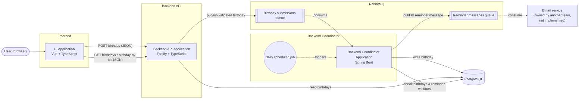

# birthday-tracker

A birthday tracking application made up of a web UI and two backend services that communicate through a message queue and share a single data store.

## Architecture

### Tech Stack

| Layer                           | Technology                     | Responsibility                                                                                                                                                                                     |
| ------------------------------- | ------------------------------ | -------------------------------------------------------------------------------------------------------------------------------------------------------------------------------------------------- |
| Frontend (UI Application)       | Vue + TypeScript               | Lets users in the browser submit birthdays (with a 1–14 day reminder window) and view a list of birthdays or a single birthday. Talks to the Backend API over HTTP/JSON.                           |
| Backend API Application         | Fastify + TypeScript (Node.js) | Validates birthday submissions and publishes them to the message queue. Serves REST endpoints that read the birthday list and individual birthdays from the database.                              |
| Backend Coordinator Application | Spring Boot (Java)             | Consumes birthday submission messages and writes them to the database. Runs a daily job that checks birthdays against their reminder windows and publishes reminder messages to the message queue. |
| Database                        | PostgreSQL                     | Shared data store for both backend services.                                                                                                                                                       |
| Message Queue                   | RabbitMQ                       | Carries birthday submissions from the Backend API to the Coordinator, and reminder messages from the Coordinator to the downstream email team's application.                                       |

### How the Pieces Connect

**Write path:** UI → Backend API (validate) → RabbitMQ → Coordinator → PostgreSQL

**Read path:** UI → Backend API → PostgreSQL

**Reminder path:** Coordinator daily job → PostgreSQL (find birthdays inside their reminder window) → RabbitMQ → email service (external)

### Technology Decisions

#### Data Store: PostgreSQL

**Choice:** PostgreSQL.

**Reasoning:** Birthday records have a straightforward relational structure. PostgreSQL provides transactions, data integrity constraints, date types, and indexing without introducing unnecessary infrastructure.

**Trade-offs:** Both backend applications must agree on the shared schema. Schema changes need to be managed carefully.

#### Message Queue: RabbitMQ

**Choice:** RabbitMQ.

**Reasoning:** Durable queues, persistent messages, acknowledgements, and redelivery support reliable asynchronous processing when configured appropriately. This allows the API and coordinator to operate independently.

**Trade-offs:** Message delivery can be repeated, so consumers must handle duplicate messages safely. Broker persistence and application-level failure handling also need to be configured.
