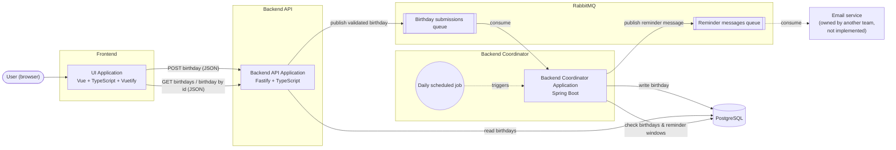

# birthday-tracker

A birthday tracking application made up of a web UI and two backend services that communicate through a message queue and share a single data store.

## Running Locally

**Prerequisites:** Docker Desktop (or Docker Engine with Compose v2). Node.js 22+ is only needed to run the frontend/API tests outside Docker.

```sh
docker compose up --build -d --wait   # build images and start the stack
./scripts/smoke-test.sh               # verify every service is healthy and wired up
docker compose down                   # stop (add -v to also delete the database and queue volumes)
```

| Service             | URL                                                                     |
| ------------------- | ----------------------------------------------------------------------- |
| UI                  | http://localhost:8081                                                   |
| Backend API         | http://localhost:3000 (also proxied by the UI at `/api`)                |
| Coordinator         | http://localhost:8082/actuator/health                                   |
| RabbitMQ management | http://localhost:15672 (user/password `birthday` / `birthday`)          |
| PostgreSQL          | `localhost:5432`, database `birthdays` (user/password `birthday` / `birthday`) |

Credentials, queue names and host ports have defaults in `docker-compose.yml`. To override them, copy `.env.example` to `.env` and edit it, e.g. if a port is already in use on your machine.

### Tests

| Layer       | Command                       | What it covers                                                         |
| ----------- | ----------------------------- | ---------------------------------------------------------------------- |
| API         | `cd api && npm test`          | Vitest; routes exercised in-process via `inject()` with a fake publisher and repository |
| Frontend    | `cd frontend && npm test`     | Vitest + Vue Test Utils (jsdom), `fetch` mocked, routes on an in-memory router |
| Coordinator | `cd coordinator && mvn test`  | JUnit 5; reminder window maths, the reminder job and message, and the submission listener (repository and publisher mocked) |
| Stack       | `./scripts/smoke-test.sh`     | Container health, endpoints, `/api` proxy, schema, a birthday submitted through the UI proxy landing in Postgres, `GET /api/birthdays` and `GET /api/birthdays/:id` returning it (plus 404/400 for unknown and malformed ids), and the reminder job publishing a due reminder (restarts the Coordinator to trigger a run, and takes the messages off `birthday.reminders`) |

All three services' tests also run during their Docker image builds, so a failing test fails `docker compose up --build` (no local Maven needed for the Coordinator).

### Troubleshooting

- **Coordinator restarts with `password authentication failed for user "birthday"`, or the `birthdays` table is missing:** Postgres only runs `db/init` when its data volume is first created. If the `pgdata` volume was created earlier with different settings, reset it with `docker compose down -v` (this deletes local data).
- **Coordinator logs `column "next_reminder_on" ... violates not-null constraint` or `relation "reminders_sent" does not exist`:** the `pgdata` volume has the schema from before the reminder job. Reset it with `docker compose down -v` (this deletes local data).
- **`ports are not available`:** another process is using a host port. Set `API_PORT`, `COORDINATOR_PORT` or `FRONTEND_PORT` in `.env`.
- **API or Coordinator fails with `PRECONDITION_FAILED - inequivalent arg 'x-dead-letter-exchange'`:** the `birthday.submissions` queue in the `rabbitmqdata` volume was declared before it had a dead-letter queue. Reset with `docker compose down -v`.

## Repository Layout

| Path           | Contents                                                                         |
| -------------- | -------------------------------------------------------------------------------- |
| `frontend/`    | Vue + TypeScript (Vite) UI built with Vuetify, served by nginx, which also proxies `/api` to the API |
| `api/`         | Fastify + TypeScript Backend API                                                 |
| `coordinator/` | Spring Boot (Java 21) Backend Coordinator                                        |
| `db/init/`     | SQL run by Postgres on first start; defines the `birthdays` table                |
| `scripts/`     | Developer scripts (stack smoke test)                                             |

## Architecture

### Tech Stack

| Layer                           | Technology                     | Responsibility                                                                                                                                                                                     |
| ------------------------------- | ------------------------------ | -------------------------------------------------------------------------------------------------------------------------------------------------------------------------------------------------- |
| Frontend (UI Application)       | Vue + TypeScript + Vuetify     | Lets users in the browser submit birthdays (with a 1–14 day reminder window) and view a list of birthdays or a single birthday. Talks to the Backend API over HTTP/JSON.                           |
| Backend API Application         | Fastify + TypeScript (Node.js) | Validates birthday submissions and publishes them to the message queue. Serves REST endpoints that read the birthday list and individual birthdays from the database.                              |
| Backend Coordinator Application | Spring Boot (Java)             | Consumes birthday submission messages and writes them to the database. Runs a daily job that checks birthdays against their reminder windows and publishes reminder messages to the message queue. |
| Database                        | PostgreSQL                     | Shared data store for both backend services.                                                                                                                                                       |
| Message Queue                   | RabbitMQ                       | Carries birthday submissions from the Backend API to the Coordinator, and reminder messages from the Coordinator to the downstream email team's application.                                       |

### How the Pieces Connect



**Write path:** UI → Backend API (validate) → RabbitMQ → Coordinator → PostgreSQL

**Read path:** UI → Backend API → PostgreSQL

**Reminder path:** Coordinator daily job → PostgreSQL (find birthdays inside their reminder window) → RabbitMQ → email service (external)

### Technology Decisions

#### Data Store: PostgreSQL

**Choice:** PostgreSQL.

**Reasoning:** Birthday records have a straightforward relational structure. PostgreSQL provides transactions, data integrity constraints, date types, and indexing without introducing unnecessary infrastructure.

**Trade-offs:** Both backend applications must agree on the shared schema. Schema changes need to be managed carefully.

#### Message Queue: RabbitMQ

**Choice:** RabbitMQ.

**Reasoning:** Durable queues, persistent messages, acknowledgements, and redelivery support reliable asynchronous processing when configured appropriately. This allows the API and coordinator to operate independently.

**Trade-offs:** Message delivery can be repeated, so consumers must handle duplicate messages safely. Broker persistence and application-level failure handling also need to be configured.

#### UI Components: Vuetify

**Choice:** Vuetify, with Material Design Icons as SVG paths (`@mdi/js`).

**Reasoning:** It covers everything the UI needs (data table with sorting and paging, form fields with error messages, alerts, cards) without adding Tailwind, follows the system's light or dark setting, and is MIT-licensed and actively maintained. `vite-plugin-vuetify` imports only the components a template uses, and icons are imported one by one, so unused ones aren't bundled. PrimeVue was the first choice, but from version 5 it's under a commercial licence that needs a licence key, and the MIT-licensed 4.x line is no longer updated.

**Trade-offs:**

- **The look is Material Design.** It can be themed (the pink accent is set in `frontend/src/vuetify.ts`), but moving far from Material is work.
- **The birthday field is a native date input inside a Vuetify text field, not Vuetify's date picker.** The date picker produces a JavaScript `Date`, which is easy to shift by a day when converting between time zones; the native input gives the `YYYY-MM-DD` string the API expects.
- **Tests drive some components through Vuetify.** The reminder window is a Vuetify select, whose list opens in an overlay, so its spec sets the value on the component rather than on a native `<select>`. jsdom lacks `ResizeObserver`, so `frontend/src/test-setup.ts` stubs it.

## Submitting a Birthday

### `POST /birthdays`

```json
{ "name": "Ada Lovelace", "birthDate": "1815-12-10", "reminderWindowDays": 7 }
```

| Status | Body | When |
| ------ | ---- | ---- |
| `202 Accepted` | `{ "id": "<UUIDv7>" }` | Valid, and RabbitMQ confirmed the message. The row appears in the database shortly after, once the Coordinator processes it. |
| `400 Bad Request` | `{ "error": "ValidationError", "message": "...", "details": [{ "field": "name", "message": "is required" }] }` | Any rule below fails. Every failing field is listed. |
| `503 Service Unavailable` | `{ "error": "ServiceUnavailable", "message": "..." }` | The message couldn't be published and confirmed within 5 seconds. |

Validation rules (in [`api/src/routes/birthdays.ts`](api/src/routes/birthdays.ts)):

- All three fields are required, and unknown fields are rejected.
- `name`: a string of up to 200 characters (the column limit), not blank. Leading and trailing whitespace is trimmed.
- `birthDate`: a real calendar date in `YYYY-MM-DD` format, not in the future (compared with today's date in UTC).
- `reminderWindowDays`: an integer from 1 to 14. Strings such as `"7"` are rejected rather than converted.

### Submission message

The API publishes this JSON to the `birthday.submissions` queue as a persistent message with publisher confirms, and the Coordinator consumes it:

```json
{ "id": "01a13d57-…", "name": "Ada Lovelace", "birthDate": "1815-12-10", "reminderWindowDays": 7, "submittedAt": "2026-10-14T12:00:00.000Z" }
```

The Coordinator inserts the row with `ON CONFLICT (id) DO NOTHING`, so a redelivered message is ignored. If a message fails (for example, it can't be parsed or the database is down), the Coordinator tries it 3 times, then rejects it. RabbitMQ then moves it to `birthday.submissions.dlq` instead of redelivering it forever. Both services declare the queue with the same dead-letter arguments, so whichever starts first creates it correctly. Nothing reads the DLQ yet; inspect it in the RabbitMQ management UI.

## Viewing Birthdays

The UI's home page (`/`) shows every birthday in a table. Each name links to that birthday's page at `/birthdays/:id`, and **Add a birthday** goes to the form at `/submit`. All three are client-side routes (Vue Router, HTML5 history); nginx serves `index.html` for any path, so reloading any of them works. A birthday page for an id that doesn't exist, or isn't a valid id, says it couldn't find the birthday.

### `GET /birthdays`

| Status | Body | When |
| ------ | ---- | ---- |
| `200 OK` | `{ "birthdays": [{ "id": "<UUIDv7>", "name": "Ada Lovelace", "birthDate": "1815-12-10", "reminderWindowDays": 7 }] }` | Always, with an empty array if there are none. Most recently added first (`created_at DESC`). |
| `500 Internal Server Error` | `{ "error": "InternalServerError", "message": "..." }` | The database query failed. |

Submissions are written asynchronously by the Coordinator, so a birthday appears in the list shortly after `POST /birthdays` returns, not immediately. The list isn't paginated yet; the response is wrapped in an object so paging fields can be added later without breaking clients.

### `GET /birthdays/:id`

| Status | Body | When |
| ------ | ---- | ---- |
| `200 OK` | `{ "id": "<UUIDv7>", "name": "Ada Lovelace", "birthDate": "1815-12-10", "reminderWindowDays": 7 }` | The birthday exists. |
| `400 Bad Request` | `{ "error": "ValidationError", "message": "Request path is invalid", "details": [{ "field": "id", "message": "must match format \"uuid\"" }] }` | `id` isn't a UUID. Checked before querying, so a malformed id can't fail as a database error. |
| `404 Not Found` | `{ "error": "NotFound", "message": "Birthday not found" }` | No birthday has that id (or the Coordinator hasn't stored it yet). |
| `500 Internal Server Error` | `{ "error": "InternalServerError", "message": "..." }` | The database query failed. |

## Reminder Messages

The Coordinator's `ReminderJob` runs daily at 06:00 UTC (`REMINDER_CRON`), and once whenever the Coordinator starts so a run missed while it was down happens straight away. For every birthday whose reminder window includes today, from `reminder_window_days` before the birthday up to and including the day itself, it publishes one reminder to the `birthday.reminders` queue unless `reminders_sent` shows it already went out:

```json
{ "reminderId": "2efade9b-…", "birthdayId": "01a13d57-…", "name": "Ada Lovelace", "birthDate": "1815-12-10",
  "birthdayOn": "2026-12-10", "reminderWindowDays": 7, "reminderEmail": null, "publishedAt": "2026-12-03T06:00:00Z" }
```

- **`birthdayOn`** is the upcoming birthday the reminder is for, so the email service doesn't need to redo the date maths. February 29 birthdays fall on February 28 in non-leap years.
- **`reminderEmail` is always `null` for now.** The UI doesn't collect an email yet, so the email team's service has to resolve the recipient until it does.
- **Delivery is at least once.** Each reminder is recorded in `reminders_sent` and published in one transaction, committed only after RabbitMQ confirms the message. If publishing fails, the record rolls back and the next run retries. If the confirm arrives but the commit fails, the next run sends it again; `reminderId` is the same for every send of one birthday's reminder in a given year, so the consumer can drop the duplicate.
- **Missed days catch up; a missed window doesn't.** Any day inside the window counts as due, so a job that was down for a few days still sends the reminder. Once the birthday has passed, it's no longer due, so a reminder is never sent after the birthday it's for.
- **A late submission still gets this year's reminder.** A birthday submitted 3 days before it happens with a 7-day window is already inside its window, so the next run (at the latest the following 06:00) sends it.
- **Several Coordinators can run the job at once.** The `reminders_sent` primary key makes a second instance's insert for the same reminder wait, then conflict, so only one publishes it.
- **The queue has no dead-letter queue.** What to do with reminders the email service can't process is that team's decision.

## Data Model

Both backends share the `birthdays` table, defined in [`db/init/001_create_birthdays.sql`](db/init/001_create_birthdays.sql). The Coordinator also owns `reminders_sent` ([`db/init/002_create_reminders_sent.sql`](db/init/002_create_reminders_sent.sql)).

| Column                 | Type          | Notes                                                                 |
| ---------------------- | ------------- | --------------------------------------------------------------------- |
| `id`                   | `UUID` PK     | UUIDv7, generated by the Backend API, not the database (see below)    |
| `name`                 | `VARCHAR(200)` | Required                                                             |
| `birth_date`           | `DATE`        | Required; the API rejects future dates                                |
| `reminder_window_days` | `SMALLINT`    | Required; the API accepts 1–14 days before the birthday               |
| `reminder_email`       | `VARCHAR(200)` | Optional for now; who the email service should send the reminder to  |
| `created_at`           | `TIMESTAMPTZ` | Defaults to `now()`                                                   |
| `updated_at`           | `TIMESTAMPTZ` | Defaults to `now()`                                                   |

Indexes: primary key on `id`, `lower(name)` for name lookups, and `created_at DESC` for the default list order.

`reminders_sent` has one row per reminder published:

| Column        | Type          | Notes                                                                       |
| ------------- | ------------- | --------------------------------------------------------------------------- |
| `birthday_id` | `UUID`        | References `birthdays(id)`; rows are deleted with the birthday              |
| `birthday_on` | `DATE`        | The birthday occurrence the reminder was for                                |
| `reminder_id` | `UUID` unique | The message's `reminderId`                                                  |
| `sent_at`     | `TIMESTAMPTZ` | Defaults to `now()`                                                         |

Primary key: `(birthday_id, birthday_on)`, so each birthday gets at most one reminder per occurrence.

**Decisions:**

- **The API generates `id` as a UUIDv7.** The API puts the id in each submission message and can return it to the UI right away (`202 Accepted`). The Coordinator writes with `INSERT ... ON CONFLICT (id) DO NOTHING`, so a message RabbitMQ delivers twice still produces only one row. v7 UUIDs are time-ordered, which keeps the primary key index compact (random v4 UUIDs scatter inserts across it).
- **Each birthday stores a `reminder_email`.** The requirements don't say who receives reminder emails, but the email team's service needs a recipient, so each reminder message includes it. It's nullable for now, until the submission form collects it; how to handle reminders without a recipient is still to be decided. Once user accounts exist, this would become an owner reference.
- **Reminders are worked out each run, and only what was sent is stored.** Each run checks every birthday's window from `birth_date` and `reminder_window_days` (`ReminderDateCalculator`, in Java, including the Feb 29 rule), then skips those already in `reminders_sent`. The alternative was storing a `next_reminder_on` date on each birthday and advancing it after each reminder, which is a cheaper indexed query but is derived state: editing a birth date or window, or changing a rule, would need it recalculated or backfilled. With nothing derived stored, edits and rule changes apply on the next run, and `reminders_sent` doubles as an audit log. Reruns and catch-up runs are safe because of its primary key.
- **The job reads every birthday each run.** That's fine for thousands or a few hundred thousand rows. At larger scale, pre-filter in SQL to birthdays whose month and day fall in the next 14 days (taking care with the year end and Feb 29), keeping the Java check as the final word.
- **`birth_date` is a plain `DATE`.** A birthday has no time or time zone. The year is kept (useful for age), and reminder dates are based on month and day.
- **The API owns validation.** Value rules (non-blank name, no future birth dates, a 1–14 day window, a valid email) live in the API, the only entry point for submissions. The database has no `CHECK` constraints and enforces only types, `NOT NULL` and the 200-character limits. The trade-off: any other code that writes to the table directly (scripts, a future service) bypasses those rules.

## Production Readiness & Future Enhancements

The message flow is built to survive failures: publisher confirms, durable queues and persistent messages, idempotent inserts, a reminder ledger, a dead-letter queue for submissions, graceful shutdown, and non-root API and Coordinator images. The gaps below are what this repo still needs before it runs in production, roughly in priority order, followed by enhancements to the data model and reminder job.

### Authentication

**Today:** none. The brief says the HTTP APIs don't need authentication, so anyone who can reach the UI can submit birthdays and read every stored one. Names and birth dates are personal data.

**Needed:**

- **User sign-in through an identity provider (OIDC).** The API verifies the access token on every request, either itself (for example with `@fastify/jwt` against the provider's JWKS) or in an API gateway in front of it.
- **Ownership.** Add an `owner_id` to `birthdays`, set from the token on `POST /birthdays` and carried in the submission message. `GET /birthdays` and `GET /birthdays/:id` return only the caller's birthdays (`404`, not `403`, for someone else's id, so ids can't be probed). The reminder recipient then comes from the owner's account, which also fills the `reminderEmail` gap.
- **Service credentials with least privilege.** Each service gets its own Postgres role (the API only needs `SELECT` on `birthdays`) and its own RabbitMQ user, limited to the queues it publishes to or consumes. Today both services share one account. Credentials come from a secret manager, not `.env`.
- **Nothing internal reachable from outside.** Only the UI is public. The API's port, the Coordinator's actuator, Postgres and the RabbitMQ management UI stay on the private network (Compose publishes them all to the host for local development).

### Dead-Letter Queue Handling

**Today:** the Coordinator retries a failing submission 3 times in-process (waiting 1s, then 2s), then rejects it, and RabbitMQ moves it to `birthday.submissions.dlq`. Nothing reads that queue or alerts on it; it's inspected by hand in the management UI. `birthday.reminders` has no DLQ, since what to do with reminders the email service can't process is that team's decision.

**Needed:**

- **Retry long enough to ride out an outage.** The retries span about 3 seconds, so a database restart or failover dead-letters every submission that arrives while it lasts. Retry transient errors (database or connection failures) for minutes, using a delayed retry queue with a TTL that dead-letters back to `birthday.submissions`, and send only permanent failures (a message that can't be parsed or fails validation) to the DLQ straight away.
- **Record why a message failed.** RabbitMQ's `x-death` header holds the queue, reason and count, but not the exception. Spring AMQP's `RepublishMessageRecoverer` publishes the failed message to the DLQ with the exception message and stack trace as headers.
- **Alert on it.** Alert when the DLQ's depth goes above zero, with a runbook that says how to inspect, fix and replay.
- **Replay tooling.** Once the cause is fixed, move messages back to `birthday.submissions` (a RabbitMQ shovel, or a small admin command). Replays are safe because the Coordinator inserts with `ON CONFLICT (id) DO NOTHING`.
- **Retention.** Set a message TTL or length limit on the DLQ so a long-unnoticed failure can't fill the broker's disk.
- **Agree a reminders policy with the email team,** including whether `birthday.reminders` gets its own DLQ. Adding one means recreating the queue, so it's cheaper to decide before launch.

### Observability

**Health checks today:** the API's `GET /health` always returns `{"status":"ok"}`. It says the process is running, but not whether it can reach Postgres or RabbitMQ. The Coordinator's `/actuator/health` includes database and broker checks, and its Kubernetes-style liveness and readiness probes are enabled.

**Health checks needed:**

- **Separate liveness from readiness in the API.** Keep `/health` as liveness (the process is up; failing it restarts the container), and add `/health/ready`, which checks Postgres (`SELECT 1`) and that the RabbitMQ connection is open. A load balancer stops sending traffic to an instance that isn't ready instead of restarting it.
- **Point the orchestrator's probes at them:** `/health` and `/health/ready` for the API, and `/actuator/health/liveness` and `/actuator/health/readiness` for the Coordinator.

**Metrics today:** none. The API exports no metrics, and the Coordinator's actuator exposes only `health` and `info`.

**Metrics needed:**

- **API:** request rate, latency and status code per route (for example `fastify-metrics`), plus a counter of failed publishes (the `503` responses).
- **Coordinator:** add `micrometer-registry-prometheus` and expose the `prometheus` endpoint. Count submissions consumed, retried and dead-lettered. For the reminder job, record reminders published per run, run duration, and the time of the last successful run.
- **RabbitMQ:** enable the `rabbitmq_prometheus` plugin for queue depth, consumer count and unacknowledged messages.
- **Postgres:** connection pool usage and slow queries.

**Alerts:**

- the DLQ's depth is above zero
- `birthday.submissions` is backing up, or has no consumers
- the reminder job hasn't succeeded in the last 25 hours
- the API's `5xx` or `503` rate goes up, or a service isn't ready

**Logs and tracing:**

- **Structured logs everywhere.** The API already logs JSON (Fastify's pino logger), and each submission's log lines include its id. The Coordinator still logs plain text; Spring Boot's structured logging (`logging.structured.format.console`) switches it to JSON.
- **Tracing.** Use OpenTelemetry in both services and propagate the trace context in AMQP message headers, so one submission can be followed from the UI through the API, the queue and the Coordinator to Postgres.

### Rate Limiting

**Today:** none. `POST /birthdays` is unauthenticated, and every accepted request becomes a queue message and a database row, so one client can flood both. `GET /birthdays` isn't paginated, so every call reads the whole table.

**Needed:**

- **A coarse per-IP limit at the edge,** with nginx `limit_req` (or the API gateway or load balancer), so floods are dropped before they reach the API.
- **Limits in the API** with `@fastify/rate-limit`, returning `429` with a `Retry-After` header: a tight limit on `POST /birthdays` and a looser one on reads. Once authentication exists, limit per user rather than per IP. With more than one API instance, keep the counters in a shared store such as Redis so the limit applies across instances.
- **Trust the proxy.** The API runs behind nginx, so without Fastify's `trustProxy` option every request appears to come from nginx's address, and a per-IP limit would throttle everyone together. Trust only the proxy's address, so clients can't spoof `X-Forwarded-For`.
- **A smaller request body limit.** Fastify accepts bodies up to 1 MiB by default; a submission is under 1 KiB, so a few KiB is plenty.
- **Pagination and sorting on `GET /birthdays`.** Page numbers (`page`, `limit`, `sort`, `order`) with a `total` count in the response, to match a server-side data table in the UI. `sort` accepts only a fixed list of columns, and sorting by birth date needs an index on `birth_date`. If the table grows large enough for `OFFSET` and `COUNT(*)` to get slow, switch to cursor pagination on `created_at` and `id`. The response is already wrapped in an object so paging fields can be added without breaking clients.

### Data Model and Reminders

- **Schema migrations.** The `db/init` scripts only run when the Postgres volume is first created. That's fine for a local stack. Production schema changes should go through a migration tool such as Flyway, owned by one service.
- **A transactional outbox for reminders.** Publishing a reminder and committing its `reminders_sent` row aren't atomic. If RabbitMQ confirms a reminder but the commit then fails, the next run sends it again (consumers dedupe on `reminderId`). Adding a `status` column to `reminders_sent` would turn it into a transactional outbox: commit the row as `pending`, then publish pending rows separately and mark them `published`.
- **Pruning `reminders_sent`.** It grows by one row per birthday per year. Prune rows older than a year if the audit trail isn't needed.
